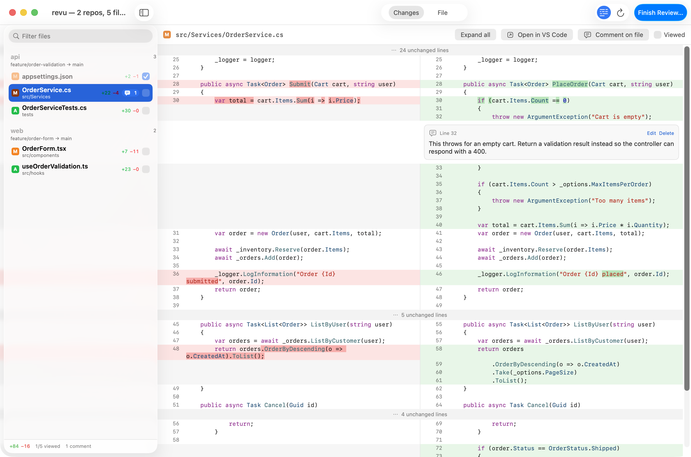
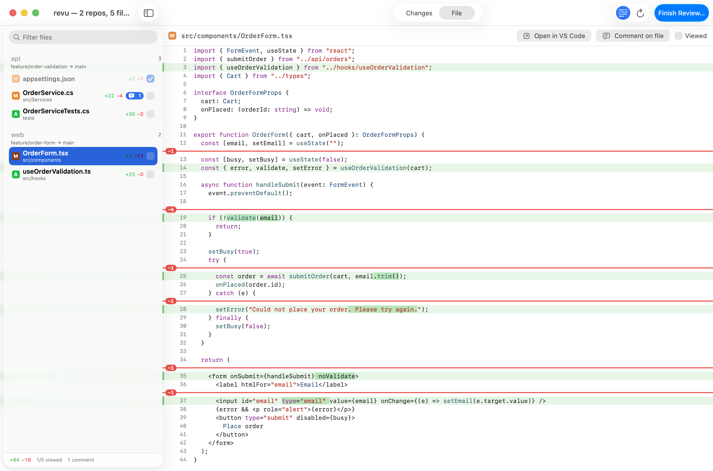

# revu

A small native macOS app for reviewing what a coding agent changed, across several repos or worktrees, like a pull request, with your comments going straight back to the agent.

```sh
brew install schneidenbach/tap/revu
```

For Claude Code, also install the skill:

```sh
npx skills@latest add schneidenbach/skills
```

<picture>
  <source media="(prefers-color-scheme: dark)" srcset="assets/screenshot-changes-dark.png">
  
</picture>

<picture>
  <source media="(prefers-color-scheme: dark)" srcset="assets/screenshot-file-dark.png">
  
</picture>

## What it does

- Shows everything that changed in one or more repos or worktrees against an auto-detected base branch, including uncommitted and untracked files.
- Side-by-side Changes view and a File view of the new file, both with syntax highlighting.
- Inline comments on a line, a range of lines, or a whole file.
- On submit, prints the review to stdout so the agent that launched revu can read it and act on it.
- Refreshes live as files change, and remembers which files you have viewed (un-viewing a file when its diff changes).
- Opens any file or line in VS Code (or Cursor, Zed).

## Q&A

**How does feedback get back to my agent?**
`revu` blocks until you submit or close the window, then prints the review (Markdown, or JSON with `--json`) to stdout and exits. An agent that ran it as a background command is woken when it exits and reads the output. With the Claude Code skill, type `/revu` (optionally followed by directories) and Claude opens the review for the repos it touched, then works through your comments. The skill only runs when you invoke it.

**How is the base branch picked, and how do I change it?**
For each repo, revu compares against the closest of `origin/HEAD`, `origin/main`, `origin/master`, `origin/develop` and the local `main`, `master`, `develop` (fewest commits since the merge-base), skipping the current branch and its upstream. On the default branch it uses the upstream, so unpushed commits show up, or `HEAD` if there is none. Override it for every repo with `--base REF`, or per directory with `dir=REF`:

```sh
revu --base origin/develop ~/code/api ~/code/web
revu ~/code/api=origin/develop ~/code/web
```

**What are the exit codes?**
`0` review submitted, `1` usage or git error (message on stderr), `2` window closed without submitting. Other options: `--json`, `--output FILE` (also write the review to a file), `--title TEXT`, `--version`.

**How do I use a different editor?**
Set `REVU_EDITOR` to `vscode` (default), `cursor`, `vscode-insiders` or `zed`. Files open through the editor's URL scheme, so the `code` command doesn't need to be on your PATH. Right-click a line, double-click a line number, or press ⇧⌘O.

**Where are reviews and drafts saved?**
In `~/Library/Application Support/revu/`. Every submitted review is kept in `reviews/` as Markdown and JSON. Unsent comments are autosaved in `drafts/` and restored when you reopen the same repos. After a submit or discard, the comments are dropped but the Viewed marks are kept, so a second round starts with unchanged files still viewed.

**What are the keyboard shortcuts?**
⌘1 / ⌘2 switch between Changes and File, ⌘R refreshes, ⌘+ / ⌘− / ⌘0 change the text size, ⇧⌘↩ finishes the review, ⇧⌘O opens the file in your editor, ⌘↩ saves a comment (Esc cancels). With focus outside a text field: `j` / `k` next or previous file, `n` / `p` next or previous change, Space marks the file viewed and moves on.

**How do I build it from source?**
You need macOS 14 or later and Swift 6 (Xcode or just the Command Line Tools). `scripts/install.sh` builds Revu.app, copies it to `~/Applications`, links `~/.local/bin/revu` and installs the Claude Code skill from `skill/revu`. `scripts/build-app.sh` only builds `build/Revu.app`. Run the tests with `scripts/test.sh`: with only the Command Line Tools selected, a plain `swift test` can't find the Swift Testing framework and runs nothing, so the script passes its location; with Xcode it is just `swift test`.

**License?**
MIT, see [LICENSE](LICENSE).
